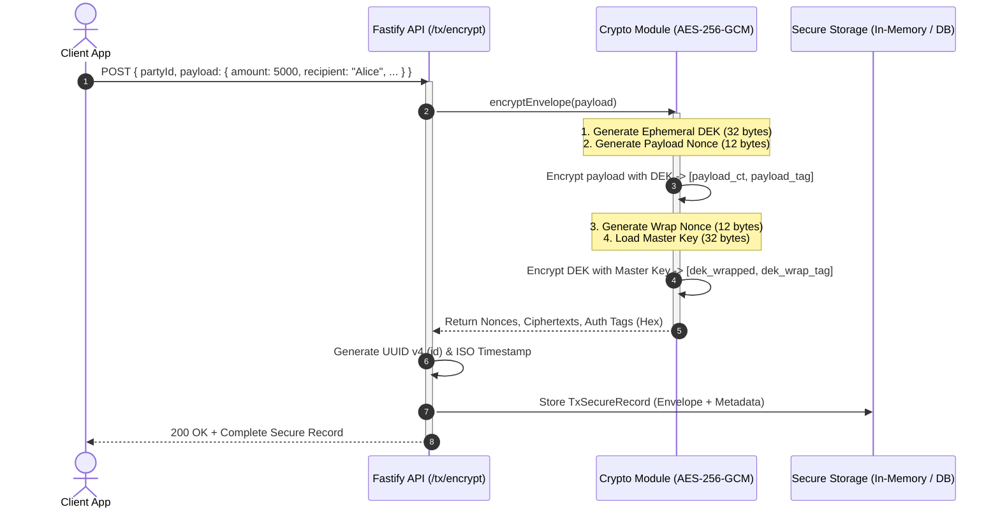
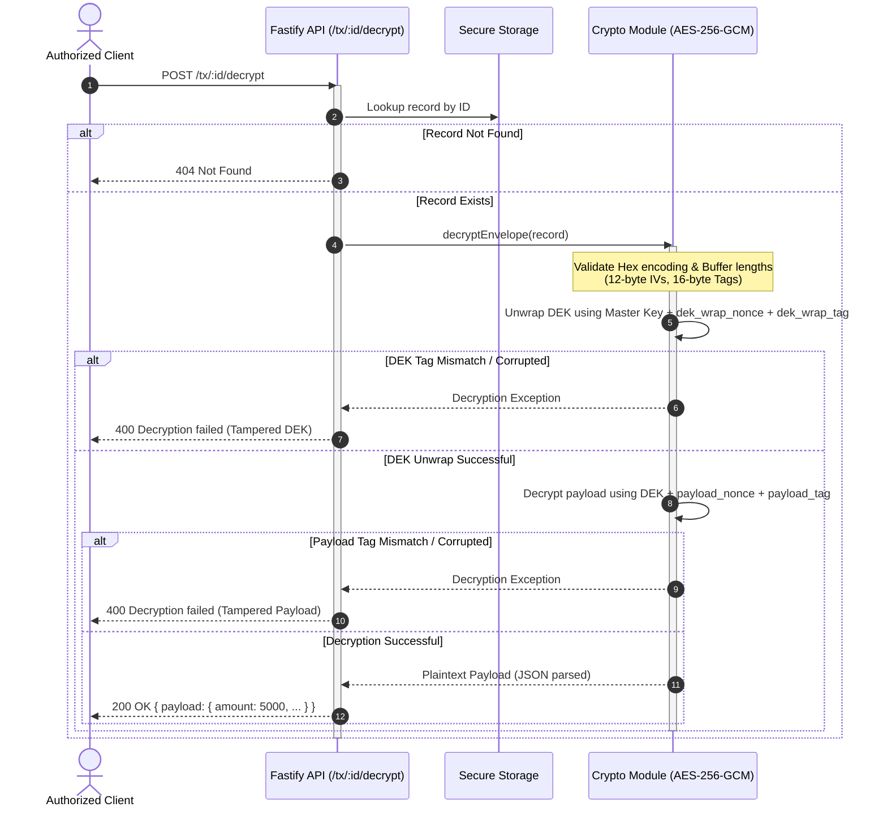

# 🔐 Secure Transactions Engine

<div align="center">

[](https://www.typescriptlang.org/)
[](https://fastify.dev/)
[](https://en.wikipedia.org/wiki/Galois/Counter_Mode)
[](https://pnpm.io/)
[](https://vercel.com/)
[](LICENSE)

<br/>

**A zero-knowledge, high-performance financial envelope encryption microservice and crypto toolkit.**  
*Protects sensitive transaction records against database exfiltration, payload tampering, and key-compromise attacks.*

[Explore Architecture](#-cryptographic-architecture--flow) •
[API Reference](#-api-reference) •
[Quickstart](#-getting-started) •
[Security Model](#-threat-model--security-guarantees)

</div>

---

## 📖 Executive Overview

Financial transactions, banking metadata, and PII (Personally Identifiable Information) require strict confidentiality and cryptographic integrity. Storing plaintext data or using static, single-key encryption introduces catastrophic vulnerabilities: if the database or static key is breached, all past and future records are exposed.

**Secure Transactions Engine** implements **KMS-Style Envelope Encryption (AEAD via AES-256-GCM)** organized as a scalable TypeScript monorepo:

1. **Per-Transaction Ephemeral Keys (DEK)**: Every transaction payload is encrypted with its own unique, randomly generated 256-bit Data Encryption Key.
2. **Master Key Wrapping (KEK)**: The ephemeral DEK is encrypted (wrapped) using an isolated Master Key (Key Encryption Key).
3. **Cryptographic Tamper-Proofing**: Galois/Counter Mode (GCM) generates 128-bit authentication tags for both the payload and the wrapped DEK. Any unauthorized bit-flip or manipulation fails decryption immediately.
4. **Zero-Knowledge Storage**: Databases and logs only hold encrypted nonces, tags, and ciphertexts. Even with direct storage dump access, attackers cannot read transaction payloads without the Master Key.
5. **Dual Runtime Ready**: Operates both as a standalone Node.js Fastify service (`port 3001`) and as serverless functions on Vercel.

---

## 📐 Cryptographic Architecture & Flow

### 1. Envelope Encryption Pipeline (`POST /tx/encrypt`)



---

### 2. Envelope Decryption & Tamper Verification (`POST /tx/:id/decrypt`)



---

## 🗂️ Monorepo Structure

This project uses **PNPM Workspaces** to cleanly separate modular cryptographic primitives from the web API runtime:

```
Secure-Transactions-Mini-App/
├── apps/
│   └── api/                         # Fastify HTTP microservice
│       ├── crypto.ts                # Envelope encryption engine
│       ├── package.json             # Service dependencies (Fastify, CORS, TypeScript)
│       ├── server.ts                # REST routes & serverless handler
│       ├── tsconfig.json            # Node/ES2022 TypeScript configuration
│       └── vercel.json              # Vercel serverless deployment routing
├── packages/
│   └── crypto/                      # Reusable crypto package (@repo/crypto)
│       ├── package.json             # Package configuration
│       └── src/
│           └── index.ts             # Core AES-256-GCM envelope functions
├── .gitignore                       # Git ignore rules
├── package.json                     # Monorepo root configuration & scripts
└── pnpm-workspace.yaml              # Monorepo workspace definition
```

---

## 🛡️ Data Schema: `TxSecureRecord`

Every encrypted transaction record adheres to a strict, tamper-evident cryptographic contract:

| Field Name | Type | Size / Format | Cryptographic Function |
| :--- | :--- | :--- | :--- |
| `id` | `string` | UUID v4 (36 chars) | Unique identifier for transaction record retrieval |
| `partyId` | `string` | UTF-8 String | Identifier for account, user, or originating party |
| `createdAt` | `string` | ISO 8601 UTC | Timestamp of cryptographic envelope creation |
| `payload_nonce` | `string` | 12 bytes (24 hex) | Cryptographically random IV used for payload encryption |
| `payload_ct` | `string` | Variable Hex | AES-256-GCM ciphertext of serialized JSON payload |
| `payload_tag` | `string` | 16 bytes (32 hex) | 128-bit authentication tag validating payload authenticity |
| `dek_wrap_nonce` | `string` | 12 bytes (24 hex) | Cryptographically random IV used for DEK key-wrapping |
| `dek_wrapped` | `string` | 32 bytes (64 hex) | AES-256-GCM ciphertext of the ephemeral Data Encryption Key |
| `dek_wrap_tag` | `string` | 16 bytes (32 hex) | 128-bit authentication tag validating DEK integrity |
| `alg` | `string` | `"AES-256-GCM"` | Cryptographic algorithm identifier |
| `mk_version` | `number` | `1` | Master Key version identifier for automated key rotation |

---

## 🚀 Getting Started

### Prerequisites

- **Node.js**: `v18.0.0` or higher (`v20.x` recommended)
- **Package Manager**: [pnpm](https://pnpm.io/) (`v9` or `v10`) or `npm`

> [!TIP]
> If you don't have `pnpm` installed, enable it via corepack:
> ```bash
> corepack enable pnpm
> ```
> Or install globally:
> ```bash
> npm install -g pnpm
> ```

---

### Installation & Setup

1. **Clone the Repository**:
   ```bash
   git clone https://github.com/Praneeth2711/Secure-Transactions-Mini-App.git
   cd Secure-Transactions-Mini-App
   ```

2. **Install Workspace Dependencies**:
   ```bash
   pnpm install
   # Or using npm inside the API directory:
   # cd apps/api && npm install
   ```

3. **Configure Environment Variables**:
   Create an `.env` file or export the Master Key secret:
   ```bash
   # Windows PowerShell
   $env:MASTER_KEY="your-super-secure-production-master-key-entropy"

   # Linux / macOS / Bash
   export MASTER_KEY="your-super-secure-production-master-key-entropy"
   ```
   *(Defaults to `dev_master_key` if unset in development mode)*.

---

### Running the Development Server

Run the development server with hot-reload via `ts-node`:

```bash
pnpm dev
```

*Output:*
```log
{"level":30,"time":1710000000000,"pid":1234,"msg":"Server listening at http://127.0.0.1:3001"}
API running at http://127.0.0.1:3001
```

The Fastify server is now running at `http://localhost:3001`.

---

## 🔌 API Reference

### 1. Encrypt Transaction Payload

Creates an ephemeral DEK, encrypts the sensitive transaction payload, wraps the DEK with the Master Key, and stores the envelope.

- **Method**: `POST`
- **Path**: `/tx/encrypt`
- **Headers**: `Content-Type: application/json`

#### Request Body
```json
{
  "partyId": "party_usr_98742",
  "payload": {
    "accountNumber": "ACC-9921-8832-1100",
    "amount": 25000.50,
    "currency": "USD",
    "recipient": "Apex Global Settlements Ltd",
    "notes": "Urgent vendor wire transfer"
  }
}
```

#### Example cURL
```bash
curl -X POST http://localhost:3001/tx/encrypt \
  -H "Content-Type: application/json" \
  -d '{
    "partyId": "party_usr_98742",
    "payload": {
      "accountNumber": "ACC-9921-8832-1100",
      "amount": 25000.50,
      "currency": "USD",
      "recipient": "Apex Global Settlements Ltd",
      "notes": "Urgent vendor wire transfer"
    }
  }'
```

#### Response (`200 OK`)
```json
{
  "id": "7f8b9e6a-4d2c-49f8-b3de-831e67fa9180",
  "partyId": "party_usr_98742",
  "createdAt": "2026-10-27T14:15:30.123Z",
  "payload_nonce": "9e5c4621c54b09e4f5a3d76e",
  "payload_ct": "4a7f058e...[truncated hex]...2d1a",
  "payload_tag": "3e4b7891cf23ab4901fa567891234def",
  "dek_wrap_nonce": "1a2b3c4d5e6f7a8b9c0d1e2f",
  "dek_wrapped": "f8a7b6c5d4e3...[64 hex chars]...1a2b",
  "dek_wrap_tag": "b8c9d0e1f2a3b4c5d6e7f8a9b0c1d2e3",
  "alg": "AES-256-GCM",
  "mk_version": 1
}
```

---

### 2. Decrypt Transaction Payload

Retrieves the encrypted record by ID, verifies authentication tags, unwraps the DEK, and decrypts the payload.

- **Method**: `POST`
- **Path**: `/tx/:id/decrypt`
- **Headers**: `Content-Type: application/json`

#### Example cURL
```bash
curl -X POST http://localhost:3001/tx/7f8b9e6a-4d2c-49f8-b3de-831e67fa9180/decrypt
```

#### Response (`200 OK`)
```json
{
  "payload": {
    "accountNumber": "ACC-9921-8832-1100",
    "amount": 25000.50,
    "currency": "USD",
    "recipient": "Apex Global Settlements Ltd",
    "notes": "Urgent vendor wire transfer"
  }
}
```

#### Error Responses
- **`404 Not Found`**:
  ```json
  { "error": "Not found" }
  ```
- **`400 Bad Request`** *(Ciphertext or Tag tampered with)*:
  ```json
  { "error": "Decryption failed" }
  ```

---

## 🔒 Threat Model & Security Guarantees

```
+------------------------------------+---------------------------------------------------------------+
| Threat Vector                      | Mitigation Mechanism                                          |
+------------------------------------+---------------------------------------------------------------+
| 💥 Database Dump / Exfiltration    | Database contains only ciphertext and wrapped DEKs. Without   |
|                                    | the external Master Key (KEK), attacker gets zero plaintext.  |
+------------------------------------+---------------------------------------------------------------+
| 🕵️ Chosen-Ciphertext Attack (CCA)  | AES-256-GCM provides AEAD. Any bit-flipping on ciphertext or |
|                                    | nonce breaks authentication tags and triggers immediate abort.|
+------------------------------------+---------------------------------------------------------------+
| 🔁 Nonce Reuse / Keystream Replay  | A fresh, cryptographically secure 12-byte random IV is        |
|                                    | generated for every single payload and every DEK wrap.        |
+------------------------------------+---------------------------------------------------------------+
| 🔑 Key Compromise Scope (DEK)      | Compromising an ephemeral DEK only exposes a single           |
|                                    | transaction payload, never the global transaction history.    |
+------------------------------------+---------------------------------------------------------------+
| 🔄 Master Key Rotation             | The `mk_version` field enables re-wrapping existing DEKs under |
|                                    | a new Master Key without decrypting the underlying payloads.  |
+------------------------------------+---------------------------------------------------------------+
```

---

## ☁️ Deployment

### Vercel Serverless Function

The application includes a root handler export in `apps/api/server.ts` configured for Vercel's `@vercel/node` runtime:

```typescript
export default async function handler(req: any, res: any) {
  await app.ready();
  app.server.emit("request", req, res);
}
```

1. Install the Vercel CLI: `npm i -g vercel`
2. Run `vercel` from `apps/api`:
   ```bash
   cd apps/api
   vercel --prod
   ```
3. Set the `MASTER_KEY` secret in your Vercel Project Environment Variables dashboard.

---

## 🛣️ Production Roadmap

- [ ] **Hardware Security Module (HSM) / Cloud KMS**: Native plugins for AWS KMS (`GenerateDataKey` / `Decrypt`), GCP Cloud KMS, and Azure Key Vault.
- [ ] **Persistent Storage Adapters**: Pluggable drivers for PostgreSQL (via Prisma / Drizzle) with pgvector / indexing, Redis, or DynamoDB.
- [ ] **Client-Side SDK**: Zero-knowledge encryption client where raw data never leaves the browser/mobile device.
- [ ] **Automated Key Rotation Cron**: Automated worker re-encrypting `dek_wrapped` upon `mk_version` increment.
- [ ] **Audit Trail & Signed Proofs**: Merkle-tree transaction audit logging for non-repudiation.

---

## 🤝 Contributing

Contributions, issues, and feature requests are welcome!  
Feel free to check the [issues page](https://github.com/Praneeth2711/Secure-Transactions-Mini-App/issues).

1. Fork the Project
2. Create your Feature Branch (`git checkout -b feature/AmazingFeature`)
3. Commit your Changes (`git commit -m 'feat: Add AmazingFeature'`)
4. Push to the Branch (`git push origin feature/AmazingFeature`)
5. Open a Pull Request

---

## 📄 License

Distributed under the **MIT License**. See [`LICENSE`](LICENSE) for more information.

---

## 👤 Author

**Varshit Peela**
- GitHub: [@Praneeth2711](https://github.com/Praneeth2711)
- Project Repository: [Secure-Transactions-Mini-App](https://github.com/Praneeth2711/Secure-Transactions-Mini-App)

<div align="center">
⭐ If you found this project helpful, please give it a star on GitHub! ⭐
</div>
